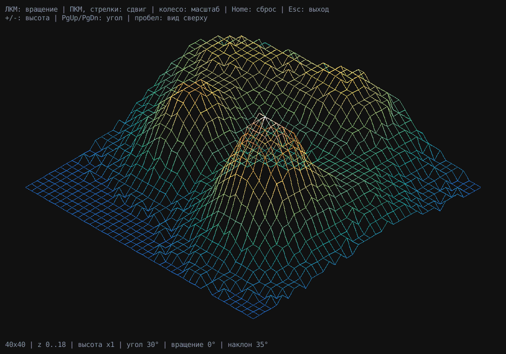

# FdF — каркасная 3D-модель карты высот



## Описание

Программа читает карту высот из текстового файла `.fdf` и рисует её проволочную
модель в изометрии. Это FdF (Fil de Fer) из программы школы 42, только на Python
вместо C с MiniLibX. Окно сделано на tkinter, он входит в стандартную библиотеку.

## Установка и запуск

Нужен Python 3.12 или новее (в Linux ещё пакет `python3-tk`).

```
python -m venv .venv
.venv\Scripts\activate              # Windows
source .venv/bin/activate           # Linux, macOS
pip install -r requirements-dev.txt
python main.py maps/42.fdf
```

`requirements-dev.txt` нужен только для тестов и проверок, сама программа обходится без него.

Если аргументов не один, программа печатает подсказку и выходит с кодом 2.
Если файла нет или в нём ошибка, пишет причину в stderr и выходит с кодом 1.

## Управление

| Клавиша | Действие |
|---|---|
| Esc, закрыть окно | выход |
| левая кнопка мыши + движение | вращение, как камера в играх: влево-вправо — поворот карты, вверх-вниз — наклон камеры (от 5° до 90°, то есть до вида строго сверху) |
| правая кнопка мыши + движение, стрелки | сдвиг |
| колесо мыши | масштаб относительно центра окна, изображение не смещается |
| + / - | выше / ниже рельеф (`z_scale` ± 0.25, при 0 карта плоская) |
| PageUp / PageDown | угол осей `angle` ± 5°, карта остаётся по центру |
| пробел | изометрия / вид сверху (X = x, Y = y, без высоты) |
| Home | вернуть вид как при запуске |

## Формат карты

Каждая строка файла — ряд точек (y), позиция числа в строке — x, само число — высота z.
Числа целые, могут быть отрицательными, разделяются пробелами.

```
0 0 0 0 0
0 2 2 2 0
0 2 5 2 0
0 2 2 2 0
0 0 0 0 0
```

- во всех строках одинаковое количество чисел, пустые строки в конце файла не считаются;
- после числа через запятую можно указать цвет точки: `20,0xFF0000`; ведущие нули
  можно не писать (`0xff` = `0x0000FF`), регистр букв любой;
- пустой файл, не число, строки разной длины, неправильный цвет — ошибка
  с номером строки и колонки: `строка 2, колонка 3: 'x' — не целое число`.

Точки без цвета раскрашиваются по высоте, как физическая карта: от синего (низко)
через зелёный и жёлтый к коричневому и белому (высоко). Если у концов ребра разные цвета,
ребро рисуется плавным переходом.

Карты для примера лежат в `maps/` (с цветами — `peak.fdf`), карты с ошибками — в `maps/bad/`.

## Структура проекта

| Файл | Что внутри |
|---|---|
| `main.py` | запуск: аргументы, сообщения об ошибках, коды возврата |
| `fdf/errors.py` | `FdfError` и `MapFormatError` (знает строку и колонку ошибки) |
| `fdf/model.py` | `Point` и `Map`: точки одним списком, соседи, рёбра каркаса |
| `fdf/parser.py` | `parse_map()` и `parse_value()` — чтение и проверка `.fdf` |
| `fdf/projection.py` | `Camera` — проекция матрицей 2x3, вписывание в окно, вращение; цвета |
| `fdf/app.py` | `App` — окно tkinter; графику импортирует только этот модуль |
| `tests/` | тесты pytest |
| `maps/` | карты |
| `docs/` | снимок экрана для README |
| `.github/workflows/ci.yml` | проверки в GitHub Actions |

## Тесты

```
pytest -q
mypy --strict fdf main.py
ruff check .
```

# Лицензия

MIT, см. [LICENSE](LICENSE).
